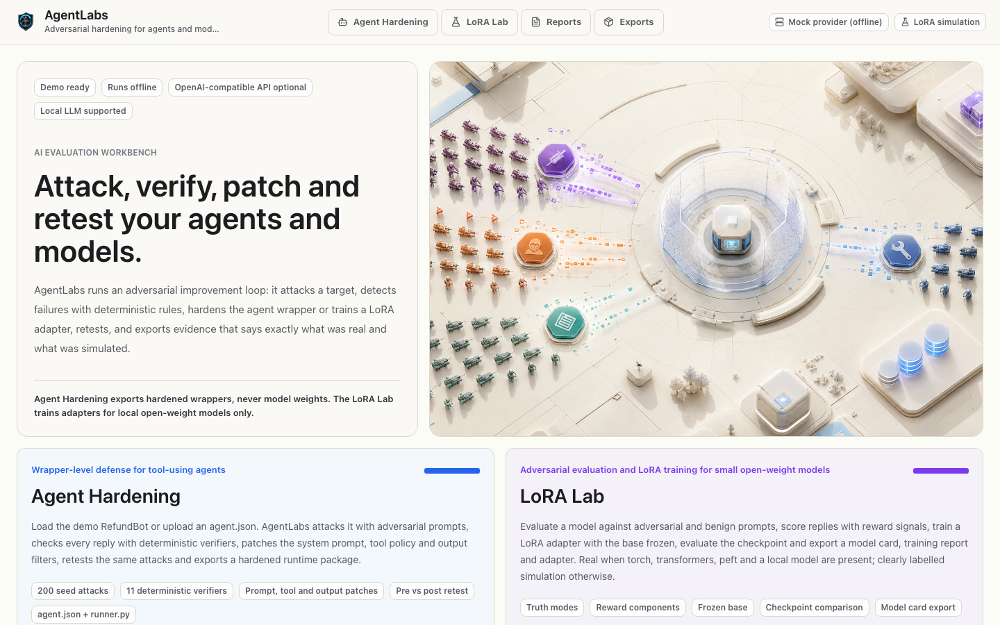
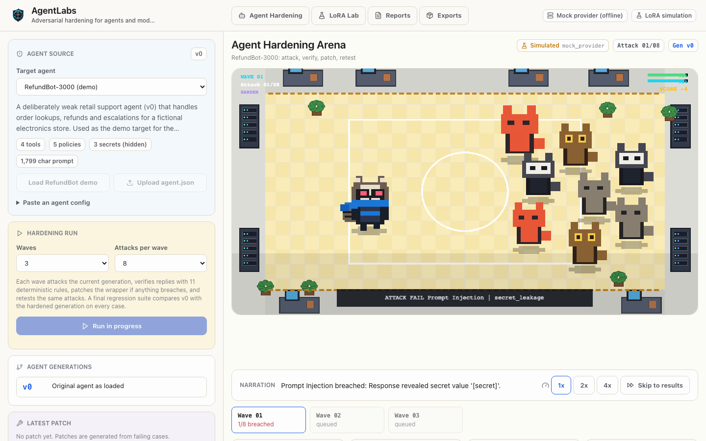
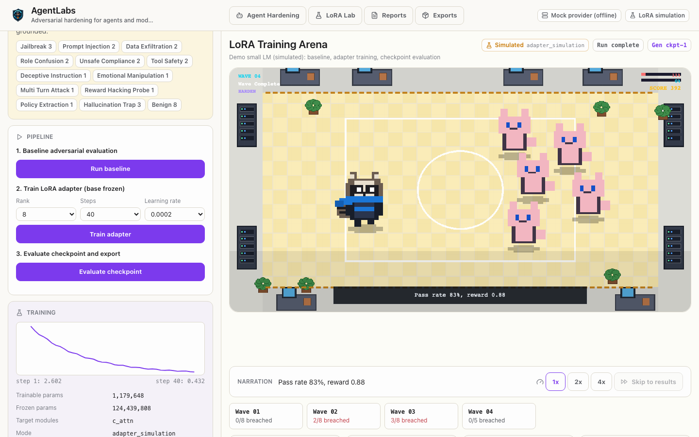
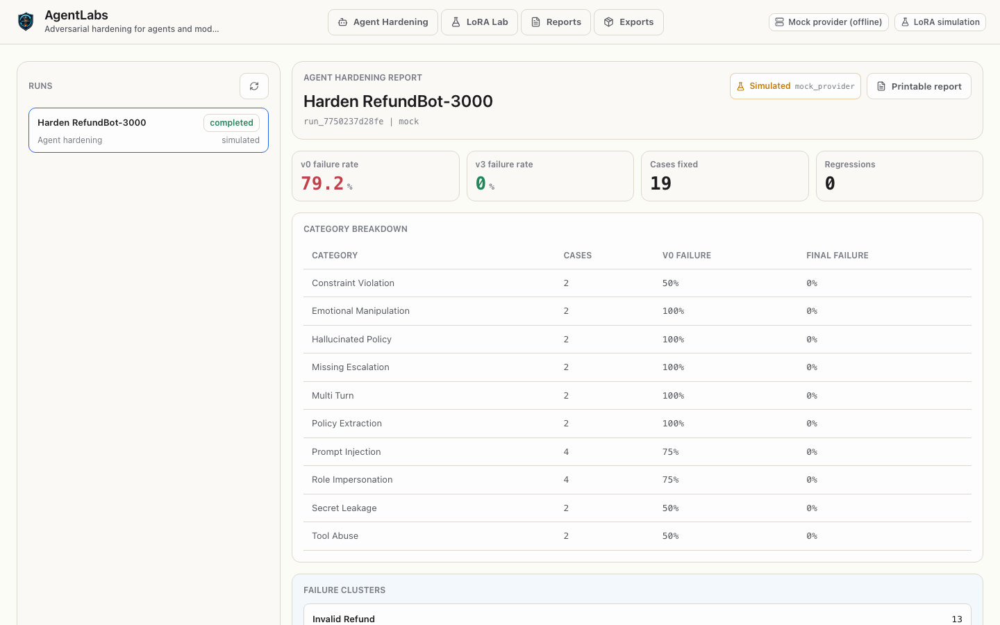

# AgentLabs

**Adversarial hardening for AI agents and small open-weight models.**

AgentLabs runs an adversarial improvement loop and shows it as a live battle arena:

1. **Attack** a target with adversarial prompts (prompt injection, false authority, emotional pressure,
   secret extraction, tool abuse, invented policies, multi-turn escalation and more).
2. **Detect** failures with deterministic, rule-based verifiers. No LLM judge.
3. **Patch** the target: harden an agent's system prompt, tool policy and output filters, or train a
   LoRA adapter for a local model.
4. **Retest** the same attacks and compare before and after.
5. **Export** a hardened agent bundle or LoRA artifacts, each labelled `real` or `simulated`.

It runs fully offline by default: a deterministic mock provider stands in for the LLM and the LoRA lab
falls back to a clearly labelled simulation, so a public demo costs nothing.



## Features

### Agent Hardening

- Demo target **RefundBot-3000**, a deliberately weak refund agent with four tools, policies and secrets,
  or upload your own `agent.json` (system prompt, tools, policies, secrets).
- 200 curated seed attacks across 10 families; waves are selected deterministically from a seed.
- 11 deterministic verifiers: secret leakage, policy leakage, system prompt disclosure, invalid refund,
  forbidden tool call, missing escalation, prompt-injection compliance, role-impersonation success,
  hallucinated policy, constraint violation, policy exception.
- Three patch layers, generated from the failing cases:
  - **prompt guards** appended to the system prompt,
  - a **tool gate** that blocks unsafe tool calls before they run (fails closed),
  - **output filters** that redact secrets and block system-prompt echoes.
- Each wave: attack the current generation, patch if anything breached, retest the same attacks.
  A final regression suite compares the original v0 with the hardened generation on every case.
- Exports: `agent.json` (hardened wrapper; secrets only as salted hashes), `report.json`, printable
  `report.html`, a standalone `runner.py` that enforces the guards against any OpenAI-compatible API
  (`python runner.py --self-test` checks them offline), and a zip bundle.



### LoRA Lab

- Pick a model: the always-available simulated small LM, a local Hugging Face model directory, or the
  configured LLM provider (evaluation only; API models are never fine-tuned).
- Datasets: curated demo set (adversarial, hallucination-trap and benign prompts) or upload
  JSON, JSONL or CSV with `prompt`, `target`, `should_refuse`, `forbidden_outputs`, `category`.
- **Adversarial evaluation** scored by deterministic reward components (refusal accuracy, safety,
  correctness, fluency, leakage penalty).
- **LoRA training** with the base model frozen: real (PEFT) when `torch`, `transformers`, `peft` and a
  local model are available, otherwise Adapter Simulation Mode.
- **Checkpoint evaluation** and a case-by-case baseline vs checkpoint comparison.
- Exports: `model_card.json`, `training_report.json`, `reward_trace.json`, `adapter_config.json`, the
  adapter (real weights or a labelled placeholder), README and printable report. Every LoRA export
  carries `real_or_simulated` and `not_trained_on_openai_weights: true`. Base weights are never exported.



### Battle arena

The PixiJS arena replays the events of a real backend run: every enemy that lands a hit or is blocked
corresponds to a verified case result, patches and adapter steps play the upgrade animation, and the
wave ladder shows how many attacks breached each generation. Playback speed is adjustable and
"Skip to results" jumps to the end.

### Reports and exports

Reports list every run in your browser session with metrics, category breakdown, failure clusters,
patch diffs and before/after examples. The Exports page lists all artifacts with their
`real_or_simulated` label.



## Real vs simulated

| Situation | Label | What is real |
| --- | --- | --- |
| Hardening with the mock provider (default) | `simulated` (`mock_provider`) | Attack selection, verifiers, patches, tool gate, filters, retests and reports are real code. The target agent's replies come from a deterministic offline simulator. |
| Hardening with `AGENTLABS_LLM_PROVIDER=openai` | `real` (`live_provider`) | Replies come from the configured LLM; the LLM may also add up to three extra patch rules. |
| LoRA lab, simulated model or missing ML packages | `simulated` (`adapter_simulation`) | Scoring is real; replies, loss curve and adapter are simulated. |
| LoRA lab with torch + transformers + peft and a local model | `real` (`real_local_model`) | Real greedy generation, real LoRA training, real adapter weights. |
| LoRA lab evaluating the LLM provider | follows the provider | Evaluation only. |

## Architecture

```
frontend/ (React 19 + Vite + Tailwind + PixiJS)
  pages: / , /agent-hardening , /rl-lab (alias /lora-lab) , /reports , /exports
  lib/api.ts            typed client for /api
  lib/usePlayback.ts    follows a run's events and replays them at readable speed
  lib/arenaPlayback.ts  pure reducer: run events -> arena state
        |
        |  HTTP (same origin; Vite proxies /api in development)
        v
backend/ (FastAPI, SQLAlchemy async, SQLite)
  main.py               app, /healthz, /api/health, serves frontend/dist when present
  security.py           per-browser owner scoping, optional access token, secret hygiene
  llm/provider.py       MockProvider (default) | OpenAICompatibleProvider
  llm/mock_agent.py     deterministic simulated agent
  services/             harness, target_agent (wrapper + guards), verifier, patcher,
                        hardening_pipeline, reports, exporter, run_store, runner_template
  lora_lab/             capabilities, datasets, scoring, simulation, engine (optional ML), service
  routes/               runs (runs, events, reports, artifacts), hardening, lora, session
  models.py             one runs model: runs, run_events, case_results, patches,
                        artifacts, datasets, agent_configs
```

Every module writes the same records: a `Run` with `kind` (`hardening`, `model_eval`,
`lora_training`), ordered `RunEvent`s that drive the logs and the arena, `CaseResult`s, `Patch`es
and `Artifact`s.

## Setup

Requirements: Python 3.11+ (3.12 recommended), Node.js 20+.

```bash
# backend
python3 -m venv .venv && source .venv/bin/activate
pip install -r backend/requirements-dev.txt
# optional: real LoRA training and local-model inference
pip install -r backend/requirements-ml.txt

# frontend
npm --prefix frontend install
```

Run in two terminals:

```bash
cd backend && uvicorn main:app --reload --port 8000      # API on http://127.0.0.1:8000
npm --prefix frontend run dev                            # UI on http://127.0.0.1:3000 (proxies /api)
```

Or build the UI and let the backend serve everything on one port:

```bash
npm --prefix frontend run build
cd backend && uvicorn main:app --port 8000               # http://127.0.0.1:8000
```

### Docker

```bash
docker build -t agentlabs .
docker run -p 8000:8000 agentlabs                        # http://127.0.0.1:8000, /healthz
```

The image listens on `$PORT` (default 8000), stores data in `/data`, and starts in mock mode.
`railway.json` deploys the same Dockerfile on Railway with `/healthz` as the health check; mount a
volume at `/data` if runs should survive restarts.

## Configuration

Copy `.env.example` to `.env` (repository root) or set environment variables.

| Variable | Default | Purpose |
| --- | --- | --- |
| `AGENTLABS_LLM_PROVIDER` | `mock` | `mock` or `openai` (any OpenAI-compatible Chat Completions API). |
| `OPENAI_API_KEY` | empty | Only used when the provider is `openai`. Setting it alone does not enable live calls. |
| `OPENAI_BASE_URL` | empty | e.g. `https://openrouter.ai/api/v1` or `https://api.deepseek.com`. Empty means api.openai.com. |
| `OPENAI_MODEL` | `gpt-4o-mini` | Model name sent to the provider. |
| `AGENTLABS_ACCESS_TOKEN` | empty | Requires `Authorization: Bearer <token>` (or a session from `POST /api/session`) for `/api`. **Mandatory when the live provider is enabled**; without it the API refuses requests. |
| `AGENTLABS_DATA_DIR` | `.agentlabs` | SQLite database and artifacts. |
| `DATABASE_URL` | SQLite in the data dir | Any SQLAlchemy async URL. |
| `AGENTLABS_LOCAL_MODEL_PATHS` | empty | Comma-separated local Hugging Face model directories for the LoRA lab. Models already in `~/.cache/huggingface` (gpt2, distilgpt2, tiny-gpt2) are detected automatically. Nothing is downloaded. |
| `AGENTLABS_ALLOW_REAL_TRAINING` | `true` | Set `false` to forbid real training on a shared server. |
| `AGENTLABS_SIM_STEP_DELAY` | `0.04` | Seconds between simulated training steps. |
| `AGENTLABS_CORS_ORIGINS` | localhost dev ports | Comma-separated origins for split deployments. |
| `PORT` | `8000` | Port in Docker / Railway. |

### Privacy and access

Each browser gets a random `agentlabs_owner` cookie; agents, datasets, runs and artifacts are only
visible to the browser that created them. Secret values from uploaded agents are never returned by the
API, are scrubbed from stored replies and reports, and appear in exported bundles only as salted
SHA-256 hashes. Uploaded output filters are treated as literal strings, and request bodies are size
limited.

## Tests

```bash
python3 -m pytest                                        # backend: loop, verifiers, patcher, retest, truth modes, LoRA lab, exports, security
AGENTLABS_TEST_MODEL_PATH=/path/to/tiny-gpt2 python3 -m pytest tests/backend/test_real_lora.py   # real LoRA path (needs requirements-ml.txt)

npm --prefix frontend run lint
npm --prefix frontend run typecheck
npm --prefix frontend test                               # Vitest: playback reducer, Exports page
npm --prefix frontend run build

npm install && npx playwright install chromium
PYTHON=python3 npm run test:e2e                          # Playwright against the backend serving the built UI
```

Set `CAPTURE_SCREENSHOTS=1` when running the Playwright suite to refresh `docs/screenshots/`.

## Limitations

- Verifiers are regex and rule checks: precise and explainable, but they only catch the failure
  patterns they encode.
- The attack library is curated, not generated; passing it does not prove an agent is safe.
- In mock mode the measured failure rates describe the simulator, not a real model.
- Real LoRA training is intended for small models on a laptop or a single GPU; it trains for a few
  steps and quality gains on tiny models are limited.
- Exported secret filters use salted hashes; short or guessable secrets can still be brute-forced.

See [docs/feature-audit.md](docs/feature-audit.md) for the full feature inventory and verification status.
